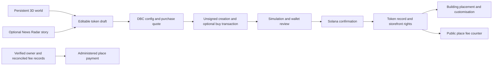

# Product architecture and V2 journey

Market.World V2 is the main exploration surface. Buildings can lead to launch preparation or a listed token. Building selection is an intention, not a reservation. A saved placement is checked by the authoritative registry; editing rights are tied to the confirmed token record and the legitimate controller.

News Radar is a discovery tool, not a launch requirement. It links an unusual physical-place story to an editable draft. The exact place and Google Maps link must be confirmed. The token can use a meme inspired by the place rather than its literal name. Metadata X links can be a profile or a public post; share-post suggestions and token metadata remain separate.

After confirmed launch, the creator can enter Building Studio to choose an available address and customise the establishment's representation. A confirmed on-chain token and a saved world placement are separate records; a preview alone does not claim a site.

The host application uses React/TypeScript and Three.js; backend services run on Cloudflare and use server-side Solana RPC. Provider credentials stay server-side. This export deliberately does not include deployment bindings or private account data.

## Reading the counter

- **Attributed to the place**: its policy share of verified eligible lifetime DBC fees.
- **Uncollected**: the attributable amount still in the pool, when verified.
- **Collected and recorded**: allocation supported by finalized receipt evidence.
- **Paid**: a separately recorded payment to the verified representative.

The refresh interval in these modules is 15 seconds, with bounded token batches and dated stale/unavailable states. An unavailable source is not a zero balance. The interface's polling, visibility and authentication wiring are in the complete host application, outside this selected source export.

The V2 code integration, production publication and on-chain payment are different milestones. A code review snapshot must not be used as evidence that all three are completed.
