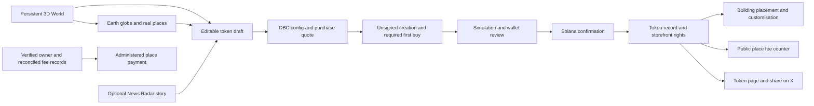

# Product architecture and V2 journey

## Discover, create, make the place your own

Market.World V2 is the main exploration surface. Buildings lead to launch preparation or a listed token; the World globe opens Earth. An occupied building cannot be assigned to another creator. Selection is an intention rather than a reservation: saved placement is checked against the authoritative registry.

Earth and News Radar are optional starting points. Earth focuses on finding physical places on a 3D globe; Radar focuses on unusual place-related stories. Both feed an editable draft with place information and token-name/ticker suggestions. Users confirm the exact establishment and its Google Maps listing. Metadata can link to an X profile or a published post; a suggested sharing post is a separate field and is editable.

The configured V2 discovery experience does not require a Citizen Pass or a $MARKET holding after reopening. The public release is still held as of 11 October 2026. The launch step requires a connected wallet and an initial purchase of 0.1–2 SOL. The review adds account setup and network costs separately, and the wallet remains responsible for approval.

After confirmed launch, Building Studio lets the legitimate creator choose an available location and customise the establishment's representation. A confirmed on-chain token and a saved world placement are distinct records. A draft or visual preview does not claim a site or prove business endorsement.

## Technical boundaries

The host uses React/TypeScript and Three.js. Backend services use Cloudflare and server-side Solana RPC. Credentials and private account data are excluded from this review package. The included constructor returns an unsigned transaction; production metadata validation, access checks, simulation, wallet approval, sending and confirmed registration are outside this source subset.

Radar combines scheduled RSS collection and selected existing provider results. Source freshness and partial/unavailable states remain explicit; an unavailable provider is not represented as complete coverage.

## Reading the counter

- **Attributed to the place:** the policy share of verified eligible lifetime DBC fees.
- **Uncollected:** the attributable amount still in the pool, when verified.
- **Collected and recorded:** allocation backed by finalized receipt evidence.
- **Paid:** a separately recorded payment to the verified representative.

The exported reader uses a 15-second refresh interval with bounded token batches and dated stale/unavailable states. An unavailable source is not a zero balance. Polling, visibility and access wiring in the complete application are outside this export. Post-migration DAMM lifetime totals remain explicitly unverified.

A V2 code integration, public reopening and on-chain payout are separate milestones. None proves the others.
